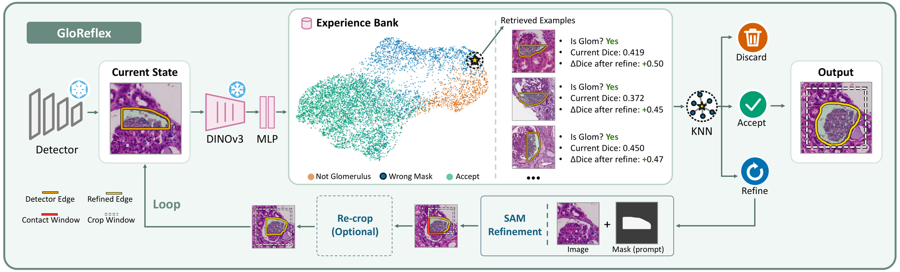

# GloReflex

**GloReflex: Experience-Guided Self-Correction for Detector-Agnostic Glomerulus Segmentation**

Glomerulus segmentation outputs can contain false positives, inaccurate masks, and glomeruli
truncated by the image window. Confidence-score filtering cannot repair these masks, while manual
correction is difficult to scale. GloReflex is an experience-guided self-correction framework that
operates on **frozen** detectors through unified **discard–refine–accept** decisions. It retrieves
similar image–mask states from an experience bank to estimate glomerulus identity, current mask
quality, and expected refinement gain. These estimates guide false-positive removal and adaptive
stopping, while adaptive field-of-view expansion enables correction of truncated glomeruli. The
correction experience transfers across detectors, so GloReflex can also be applied to a detector
without using any of its outputs (zero-shot).



## Method in brief

| Step | What happens | Code |
|---|---|---|
| Geometric filter | drop predictions with aspect ratio > 3 or size < 50 µm | `tools/run_correction.py` |
| State | 1.5x square patch around the box + current mask | `gloreflex/geometry.py` |
| State encoder | mask overlay -> frozen DINOv3 ViT-B/16 -> 2-layer MLP (128-d) | `gloreflex/encoder.py` |
| Retrieval | k = 15 nearest neighbours in the experience bank, similarity-weighted labels | `gloreflex/bank.py` |
| Decision | gradient-boosting read-outs give P(glomerulus) and the expected Dice change; discard at t = 0 if P < tau_g, accept if the gain <= tau_s or t = 5, otherwise refine | `tools/run_correction.py` |
| Refiner | SAM2.1 (Hiera-B+) with LoRA, prompted with the current mask only | `gloreflex/refiner.py` |
| Field-of-view expansion | if > 1% of the refined contour lies on the patch border, extend the touched sides by 10-40% and re-read the patch (at most twice) | `gloreflex/recrop.py` |
| Merge | slide-level mask NMS (IoU 0.5, by detector score) | `gloreflex/nms.py` |

tau_g and tau_s are set with `--fp-thresh` (default 0.5) and `--stop-delta` (default 0.005) of
`tools/run_correction.py`; choose them for your own data. No ground truth is used at test time, and the
detector is never retrained.

## Repository layout

```
gloreflex/            library: WSI I/O, geometry, refiner, encoder, experience bank, NMS, stitching, metrics
tools/
  data/               WSI annotations -> tiled instance-segmentation COCO (+ YOLO / polygon variants)
  detectors/          detector configs, training launchers, tiled WSI inference
  experience/         building the experience bank (labels, refiner training, experience collection,
                      DINOv3 features, encoder head, bank + read-outs)
  run_correction.py   GloReflex inference (discard / refine / accept, field-of-view expansion, NMS)
  eval/               scoring, cross-tile stitching baseline, paired bootstrap confidence intervals
```

## Installation

GloReflex and the detectors use separate environments (the detector frameworks pin
different PyTorch versions). Clone the repository and install the package (no dependencies are
pulled in) into every environment you use:

```bash
git clone https://github.com/hrlblab/GloReflex.git && cd GloReflex
pip install -e .
```

**GloReflex** (tested with Python 3.11, PyTorch 2.6 / CUDA 12.4):

```bash
pip install -r requirements.txt
pip install git+https://github.com/facebookresearch/sam2.git
# SAM2.1 Hiera-B+ checkpoint
wget -P checkpoints https://dl.fbaipublicfiles.com/segment_anything_2/092824/sam2.1_hiera_base_plus.pt
export SAM2_CKPT=checkpoints/sam2.1_hiera_base_plus.pt
```

The encoder backbone `facebook/dinov3-vitb16-pretrain-lvd1689m` is gated on Hugging Face: accept its
license and log in (`huggingface-cli login`) before the first run. OpenSlide must be installed on the
system (e.g. `apt install openslide-tools`).

**Detectors** (official implementations; tested versions):

| Detector | Framework | Environment |
|---|---|---|
| Mask R-CNN, SOLOv2, Mask2Former | MMDetection 3.3.0 | PyTorch 2.1, mmcv 2.1.0, mmengine 0.10 |
| YOLO11-seg (`yolo11l-seg.pt`) | ultralytics 8.4.51 | PyTorch 2.4 |
| MaskDINO (R50) | detectron2 0.6 + [MaskDINO](https://github.com/IDEA-Research/MaskDINO) | PyTorch 2.1; clone MaskDINO into `third_party/MaskDINO` |

## Data format

All coordinates are level-0 pixels of the WSI.

**WSI-level JSON** (one per split, e.g. `data/train_wsi.json`, `data/val_wsi.json`, `data/test.json`):

```json
{"images": [{"id": 1, "wsi_id": "kpmp__0001", "file_name": "/path/to/slide.svs",
             "width": 29894, "height": 12481, "source_dataset": "kpmp",
             "mpp_x": 0.2527}],
 "annotations": [{"id": 1, "image_id": 1, "category_id": 1,
                  "bbox": [11332, 29975, 664, 680], "wsi_instance_id": 1}],
 "categories": [{"id": 1, "name": "glomerulus"}]}
```

**Polygons**: `data/polygons/<wsi_id>/<wsi_instance_id>.json` with
`{"exterior": [[x, y], ...], "holes": [[[x, y], ...], ...]}`.

**Predictions**: `<dir>/wsi_preds/<wsi_id>.json` with
`{"wsi_id": ..., "preds": [{"bbox": [x0, y0, x1, y1], "score": s, "seg": {"size": [h, w], "counts": "..."}}]}`,
where `seg` is a COCO RLE local to the box, sorted by descending score.

## Usage

### 1. Detectors

```bash
# training tiles (1024 px, stride 768) for train and val
python tools/data/build_instseg_tiles.py --gt-json data/train_wsi.json --poly-root data/polygons --split train --out data
python tools/data/build_instseg_tiles.py --gt-json data/val_wsi.json   --poly-root data/polygons --split val   --out data
python tools/data/coco_to_yolo_seg.py --coco-root data/instseg_coco --img-root data --out data/instseg_yolo   # YOLO
python tools/data/coco_rle_to_polygon.py --in data/instseg_coco/train.json --out data/instseg_coco_poly/train.json  # MaskDINO
python tools/data/coco_rle_to_polygon.py --in data/instseg_coco/val.json   --out data/instseg_coco_poly/val.json

# training (official recipes, total batch 16; YOLO 64)
bash tools/detectors/train_mmdet.sh mask_rcnn 0,1 8
bash tools/detectors/train_yolo_seg.sh data/instseg_yolo/dataset.yaml 0,1
python tools/detectors/train_maskdino.py --config-file tools/detectors/configs/maskdino_glo.yaml --num-gpus 4 \
    --data-root data --train-json data/instseg_coco_poly/train.json --val-json data/instseg_coco_poly/val.json

# tiled WSI inference (run on the train and test slides)
python tools/detectors/infer_wsi.py --framework mmdet --config tools/detectors/configs/mask_rcnn_glo.py \
    --weights work_dirs/mask_rcnn/epoch_12.pth --gt-json data/test.json --out work/mask_rcnn/preds/test
```

### 2. GloReflex

Main components (all scripts print their options with `--help`):

| Component | Script |
|---|---|
| keep the score >= 0.3 prefix of the training predictions | `tools/experience/truncate_preds.py` |
| mask descriptors used by the geometric filter | `tools/experience/extract_det_features.py` |
| relation of training detections to the ground truth | `tools/experience/label_detections.py` |
| patches, detector masks and GT masks for the refiner | `tools/experience/build_refiner_trainset.py` |
| SAM2.1 LoRA refiner | `tools/experience/train_refiner.py` |
| experience collection (refinement rollouts with field-of-view expansion) | `tools/experience/collect_experience.py` |
| DINOv3 features of all states | `tools/experience/embed_states.py` |
| encoder head | `tools/experience/train_state_head.py` |
| experience bank and read-out models | `tools/experience/build_bank.py` |
| inference: discard / refine / accept, field-of-view expansion, mask NMS | `tools/run_correction.py` |
| baseline: stitching + geometric filter + score threshold + mask NMS | `tools/eval/stitch_baseline.py` |
| scores and paired bootstrap confidence intervals | `tools/eval/evaluate.py`, `tools/eval/bootstrap_ci.py` |

Inference on new slides needs the detector predictions, `extract_det_features.py` (without
`--poly-root`) and `run_correction.py`:

```bash
python tools/experience/extract_det_features.py --preds-dir work/mask_rcnn/preds/test/wsi_preds \
    --gt-json data/test.json --out-dir work/mask_rcnn/feats_test
python tools/run_correction.py --bank work/mask_rcnn/bank --head work/mask_rcnn/state_head \
    --refiner work/mask_rcnn/refiner --preds-dir work/mask_rcnn/preds/test/wsi_preds \
    --feats work/mask_rcnn/feats_test/det_features.csv --gt-json data/test.json \
    --fp-thresh 0.5 --stop-delta 0.005 --out work/mask_rcnn/corrected
```

### 3. Zero-shot transfer to a new detector

GloReflex can be built from the experience of other detectors and applied to a detector without any of
its outputs: train the encoder head and the bank on the embeddings of the other detectors and use a
refiner trained on one of them.

```bash
python tools/experience/train_state_head.py --emb work/solov2/embed work/mask2former/embed work/maskdino/embed \
    --out work/zero_shot/state_head
python tools/experience/build_bank.py --emb work/solov2/embed work/mask2former/embed work/maskdino/embed \
    --head work/zero_shot/state_head --out work/zero_shot/bank
python tools/run_correction.py --bank work/zero_shot/bank --head work/zero_shot/state_head \
    --refiner work/solov2/refiner --preds-dir work/mask_rcnn/preds/test/wsi_preds \
    --feats work/mask_rcnn/feats_test/det_features.csv --gt-json data/test.json --out work/zero_shot/corrected
```

### Evaluation

`tools/eval/evaluate.py`: a prediction is a true positive if its box overlaps an unmatched GT glomerulus
with IoU >= 0.5 (greedy matching in descending score; predictions with score < 0.3 are ignored). It
reports recall, precision, F1, COCO-style mask AP (IoU 0.50:0.95, 101-point interpolation, pooled over
slides) and the mean Dice of matched instances. `tools/eval/bootstrap_ci.py` gives paired slide-level
bootstrap confidence intervals (10,000 resamples; 2,000 for AP).

## License

BSD 3-Clause, see [LICENSE](LICENSE).
